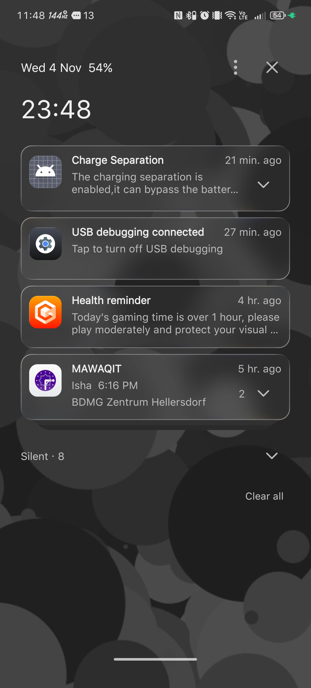
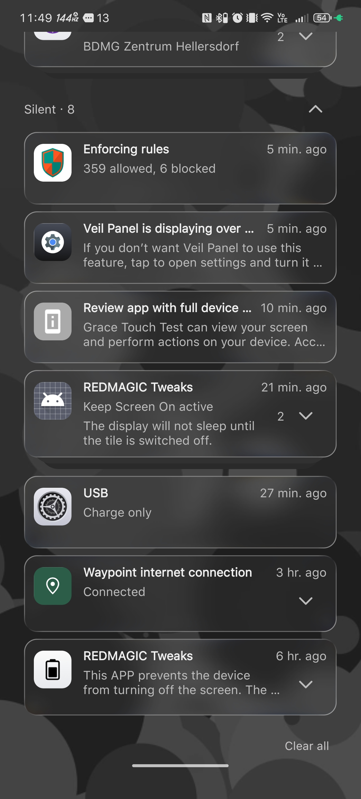
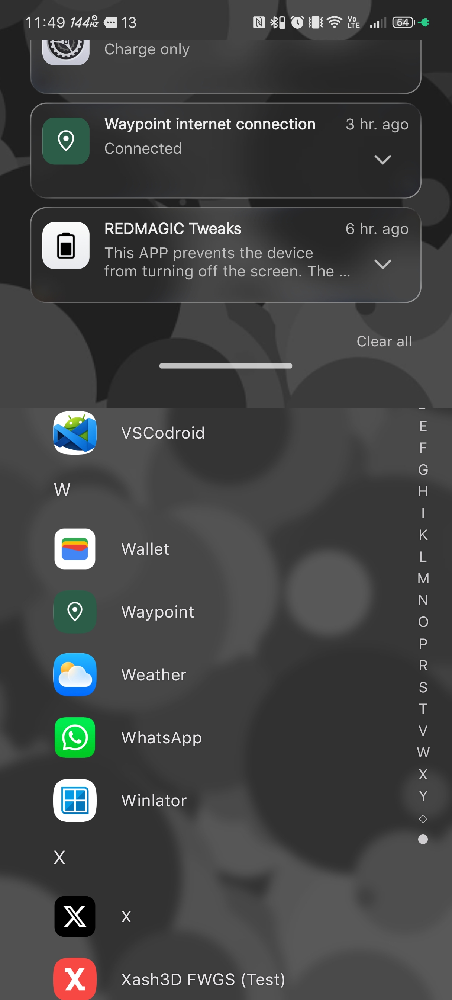
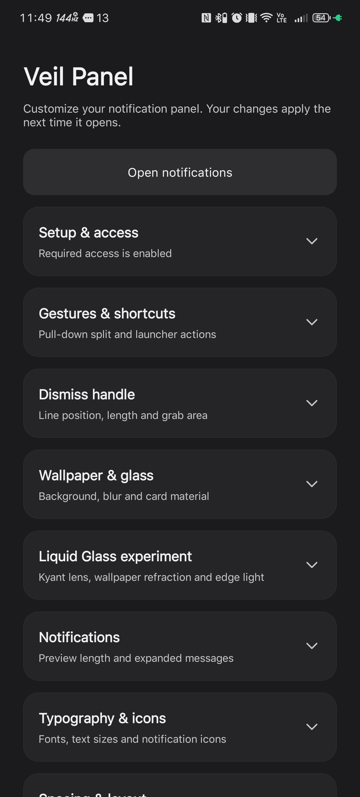
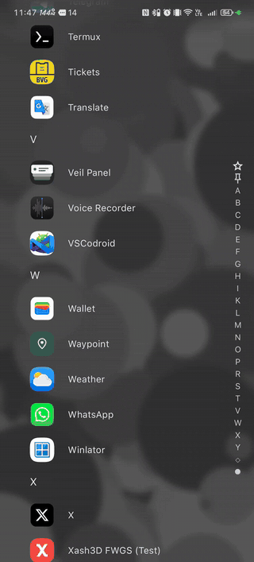

# Veil Panel

**A customizable notification panel for Android.**

Veil Panel gives you control over how your notifications look and behave. Choose a preset or build your own layout with custom cards, fonts, colors, wallpapers, and glass effects.

It works alongside your existing launcher and Quick Settings, without root or Shizuku.

**Android 13+ · Experimental**

[Download](https://github.com/ubaimutl/VeilPanel/releases) · [Getting started](docs/GETTING_STARTED.md) · [Known limitations](docs/LIMITATIONS.md) · [Privacy](docs/PRIVACY.md)

## Preview

These screenshots were captured on a REDMAGIC 10 Pro running Android 16. Veil Panel is highly customizable, so your setup doesn't have to look like this.

|                            Notification panel                             |                  Expanded silent notifications                   |
| :-----------------------------------------------------------------------: | :--------------------------------------------------------------: |
|  |  |

|                                Drag to dismiss                                |                          Appearance settings                          |
| :---------------------------------------------------------------------------: | :-------------------------------------------------------------------: |
|  |  |

[Watch the full demo (23 seconds)](docs/media/veil-panel-demo.mp4)

## Features

- **Presets:** Start with a ready-made design and customize it.
- **Notification cards:** Adjust spacing, sizes, corners, icons, and text.
- **Clock and date:** Customize their appearance, typography, and layout.
- **Wallpaper and glass:** Choose a background image and adjust blur and transparency.
- **Backup and restore:** Save your configuration and bring it back whenever you need it.

### Manage notifications

- Group notifications from the same app into expandable stacks.
- Open, dismiss, or interact with notifications using their available actions.
- Reply directly when a notification supports it.
- Keep silent notifications collapsed until you want to see them.

### Familiar gestures

Pull down from the left to open Veil Panel. Pull down from the right to access your phone's regular Quick Settings.

Close Veil Panel by dragging the bottom handle or tapping it.

Your launcher, status bar, and system Quick Settings remain in place.

## Installation

1. Download the latest APK from [Releases](https://github.com/ubaimutl/VeilPanel/releases).
2. Install and open Veil Panel.
3. Go to **Setup & access** and enable the three requested permissions.
4. Pull down from the left side of the screen to try the default panel.
5. Open **Presets** or **Wallpaper & glass** to start customizing.

Veil Panel comes with a default layout, so you can try it immediately without configuring its appearance.

For permission explanations, gesture instructions, and backup options, see the [Getting started guide](docs/GETTING_STARTED.md).

## Compatibility

**Currently tested on:**

- REDMAGIC 10 Pro — Android 16

Veil Panel requires **Android 13 or newer** and a device with separate notification and Quick Settings panels.

Devices that use a single combined panel are not supported yet.

Android handles some system gestures differently depending on the manufacturer, so opening and dismissing Veil Panel may behave differently across devices and apps.

The project is still experimental. Testing on other devices is welcome, but compatibility cannot be guaranteed.

See [Known limitations](docs/LIMITATIONS.md) for more details.

## Privacy

Veil Panel is designed to work entirely on your device.

- No Internet permission
- No ads or analytics
- No accounts or cloud services
- Notifications, settings, and saved images stay local
- Backups are exported only when you choose to save them

The app needs access to notifications and certain system features to function. These permissions are explained in the [Privacy and permissions guide](docs/PRIVACY.md).

## Contributing

Contributions, bug reports, and device compatibility feedback are welcome.

If something doesn't work, [open an issue](https://github.com/ubaimutl/VeilPanel/issues) and include your device model, Android version, and steps to reproduce the problem. Logs or screenshots can help, but make sure to remove any personal information.

If you'd like to contribute code, start with [CONTRIBUTING.md](CONTRIBUTING.md) and the [development guide](docs/DEVELOPMENT.md).

The required GibModules source is included in the repository.

## License and credits

Veil Panel is based on [PanOSP](https://gitlab.com/gibdev-group/gibapps/panosp) and is distributed under **GPL-3.0-or-later**.

See [LICENSE](LICENSE), [NOTICE](NOTICE), and [third-party notices](THIRD_PARTY_NOTICES.md) for licensing information and credits for the original project, libraries, glass shaders, and fonts.
